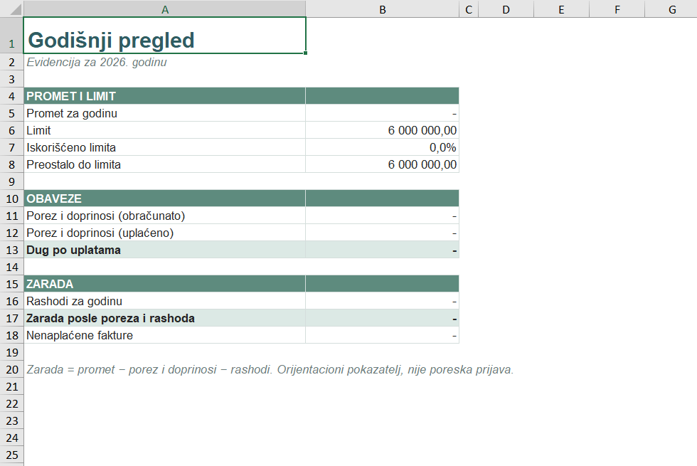
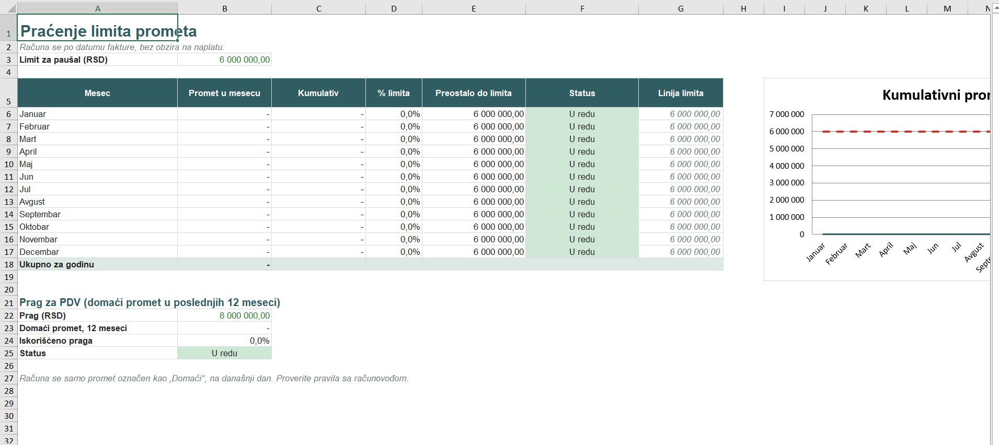
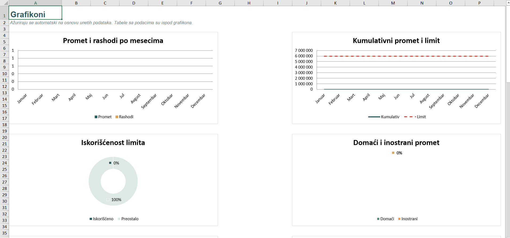
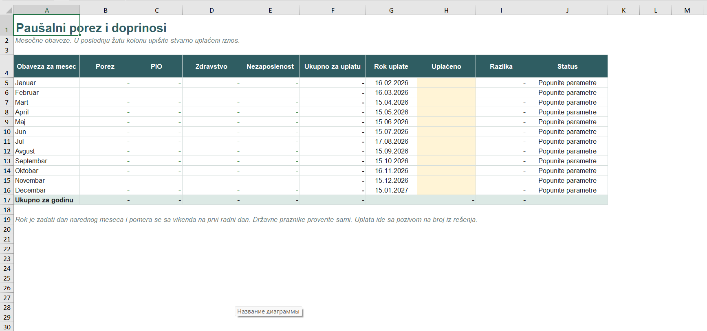

# Paušalac Tracker: Excel workbook for flat-rate entrepreneurs in Serbia

A ready-to-use Excel workbook for tracking income, the annual turnover limit, monthly tax and contributions, and profit for a **paušalac** (flat-rate taxed sole proprietor) in Serbia. No macros, no add-ins: only formulas, data validation, conditional formatting and charts, so it works in Excel and LibreOffice.

The interface is in Serbian (Latin script), because the target users are Serbian entrepreneurs.

> **Disclaimer.** This is a record-keeping tool, not a tax return and not tax advice. Limits, amounts and deadlines are entered as parameters and change over time. Always check current values with the Tax Administration (Poreska uprava, ePorezi) or an accountant.

## The problem

Entrepreneurs on flat-rate taxation in Serbia do not need full double-entry bookkeeping, but they still have to:

- keep a record of all turnover and stay under the annual limit (6,000,000 RSD) or lose the flat-rate status;
- watch the VAT threshold (8,000,000 RSD of domestic turnover over 12 months);
- pay the monthly flat tax and contributions on time.

Most people track this in a messy spreadsheet or not at all, and notice problems only when the limit is already exceeded.

## What it does

| Sheet | Purpose |
|---|---|
| **Uputstvo** | Instructions, the rules the workbook is based on, and a sample row |
| **Pregled** | Yearly overview: turnover, remaining limit, tax paid vs. due, profit |
| **Grafikoni** | 8 auto-updating charts |
| **Parametri** | Year, limits, monthly tax and contribution amounts, payment day |
| **Prihodi** | Income log (500 rows): invoice, client, domestic/foreign, currency, NBS rate, RSD amount, paid or not |
| **Rashodi** | Expense log with categories (for real profit, not required for the flat tax) |
| **Limit** | Monthly and cumulative turnover, % of the limit used, status, VAT threshold tracking |
| **Porez i doprinosi** | 12-month payment schedule with due dates, amounts paid and overdue status |

### Features

- **Limit tracking** with status labels: `U redu` (OK), `Blizu limita` (close to the limit), `LIMIT PREKORAČEN` (exceeded).
- **VAT threshold** monitor based on domestic turnover for the last 12 months.
- **Foreign currency** invoices converted to RSD by the NBS rate you enter; a row with a missing rate is highlighted instead of silently counted as zero.
- **Payment calendar:** due dates move off weekends to the next working day; rows turn red when a payment is overdue.
- **Input cells are clearly separated** from formulas (yellow cells = input, everything else is calculated).
- **Dropdowns** for transaction type, currency, paid status and expense category.

## Screenshots

| Overview | Limit tracking |
|---|---|
|  |  |

| Charts | Payment schedule |
|---|---|
|  |  |

## How to use

1. Download `pausal_evidencija.xlsx` and open it in Excel or LibreOffice.
2. On **Parametri**, set the year, limits, and your monthly tax and contribution amounts (from your Tax Administration decision).
3. Log every invoice on **Prihodi**. Only the yellow cells are inputs.
4. Mark payments on **Porez i doprinosi** as you make them.
5. Check **Pregled**, **Limit** and **Grafikoni** at any time.

A demo file with fictional data is in `demo/`.

## Technical notes

- About 2,800 formulas, built around `SUMIFS`, `IF`, `EDATE`, `WORKDAY` and `MIN`/`MAX`.
- Data validation lists, conditional formatting for statuses, and native Excel charts (column, line, doughnut, pie, bar).
- Recalculated and tested with sample data; no formula errors.
- Exact legal amounts are deliberately left as parameters rather than hard-coded.

## Possible improvements

- Import bank statements and match payments to invoices.
- Reminders for payment deadlines and the annual fees (e.g. eco tax).
- A web version of the same logic.

## Author

Bogdan, Belgrade, Serbia. Interested in data analysis, e-commerce and marketing analytics.
[LinkedIn](https://www.linkedin.com/in/your-profile) · [GitHub](https://github.com/your-username)
